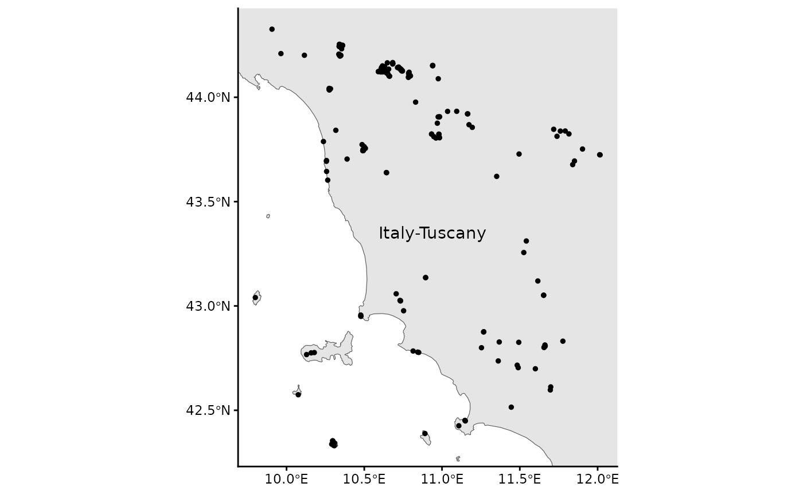
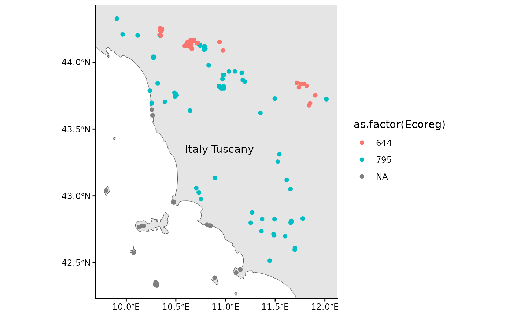

# Get EUNIS habitat types

This vignette shows how to classify European vegetation relevés into
**EUNIS habitat types** using the expert system of Chytrý et
al. ([2020](https://doi.org/10.1111/avsc.12519)). Habitat descriptions
are available on [FloraVeg.EU](https://floraveg.eu/habitat/) (Chytrý et
al. [2024](https://doi.org/10.1111/avsc.12798)) and the [EEA EUNIS
website](https://www.eea.europa.eu/en/datahub/datahubitem-view/123d0c9a-a6fa-4f2d-b887-5d8e5468faed).

First,
[`resy_harmonize_eunis()`](https://florian-jansen.github.io/resy/reference/resy_harmonize_eunis.md)
prepares the plot data. It adds geographic information such as country,
ecoregion and coastal position, and checks and adjusts the coordinate
format and species names to meet the expert system’s requirements. Then,
[`resy_classify()`](https://florian-jansen.github.io/resy/reference/resy_classify.md)
assigns the relevés to habitat types using their species composition and
site data.

## Example

The following R packages are required to run the example of this
vignette:

``` r

library(readr)
library(dplyr)
library(ggplot2)
library(sf)
library(RESY)
```

### Load the example data

The example data include the species table with the vegetation relevés
and the header table with the location of each relevé.

First, load the vegetation relevés:

``` r

data_species <- read_csv(
  system.file("extdata", "data_example_species.csv", package = "RESY")
  )
data_species
#> # A tibble: 3,580 × 3
#>    PlotObservationID Cover_Perc scientificName                                  
#>    <chr>                  <dbl> <chr>                                           
#>  1 HU32                     0.1 Dryopteris filix-mas (L.) Schott                
#>  2 HU32                     0.1 Cephalanthera longifolia (L.) Fritsch           
#>  3 HU32                     0.5 Prenanthes purpurea L.                          
#>  4 HU32                     0.5 Anemone nemorosa L.                             
#>  5 HU32                     0.5 Epipactis helleborine (L.) Crantz subsp. helleb…
#>  6 HU32                     0.5 Sorbus aucuparia L. subsp. aucuparia            
#>  7 HU32                    87.5 Fagus sylvatica L.                              
#>  8 HU32                     3   Rubus hirtus Waldst. & Kit.                     
#>  9 HU32                     3   Abies alba Mill.                                
#> 10 HU32                     3   Oxalis acetosella L.                            
#> # ℹ 3,570 more rows
```

[`resy_clean_names()`](https://florian-jansen.github.io/resy/reference/resy_clean_names.md)
removes the author names from the species names and keeps rank markers
such as `subsp.` and `var.`:

``` r

data_species$scientificName <- resy_clean_names(
  data_species$scientificName
  )
```

Second, load the header table:

``` r

data_sites <- read_csv(
   system.file("extdata", "data_example_sites.csv", package = "RESY")
   ) |>
   st_as_sf(coords = c("Longitude", "Latitude"), crs = 4326)
data_sites
#> Simple feature collection with 200 features and 1 field
#> Geometry type: POINT
#> Dimension:     XY
#> Bounding box:  xmin: 9.809499 ymin: 42.32483 xmax: 12.08963 ymax: 44.32464
#> Geodetic CRS:  WGS 84
#> # A tibble: 200 × 2
#>    PlotObservationID            geometry
#>  * <chr>                     <POINT [°]>
#>  1 JZ37               (9.93798 44.32464)
#>  2 FR49              (11.09287 43.91546)
#>  3 PT45              (11.65339 43.09104)
#>  4 ZH63              (10.53301 43.73897)
#>  5 TF93              (10.40239 44.23978)
#>  6 KG68              (10.40203 44.24087)
#>  7 QJ27               (10.40635 44.2413)
#>  8 JN90              (10.40602 44.24296)
#>  9 ZM18              (10.66071 44.12734)
#> 10 BQ20               (10.6589 44.12456)
#> # ℹ 190 more rows
```

### Map the sites

The vegetation relevés of the example dataset are in Tuscany in Italy.



The map shows part of Italy, mainly Tuscany, and the Tyrrhenian Sea. The
dots are the locations of the vegetation relevés. Some are on islands.

## Get additional data

### Load the expert system

[`resy_load_expert()`](https://florian-jansen.github.io/resy/reference/resy_load_expert.md)
reads the EUNIS expert system.
[`resy_harmonize_eunis()`](https://florian-jansen.github.io/resy/reference/resy_harmonize_eunis.md)
uses it to check the species names.

``` r

parsed_expert_file <- resy_load_expert(scheme = "EUNIS")
```

### Apply `resy_harmonize_eunis()`

[`resy_harmonize_eunis()`](https://florian-jansen.github.io/resy/reference/resy_harmonize_eunis.md)
prepares the header table and the species table:

``` r

outcome <- resy_harmonize_eunis(
   data = data_sites,
   run_taxonomy = TRUE,
   species_data = data_species,
   parsed = parsed_expert_file,
   run_coast_dunes = TRUE,
   coast_buffer = 5000
   )
#> Warning: "Altitude (m)" is missing. See vignette("altitude-vignette") and
#> mapsforeurope.org for a raster source.
#> Warning: "Ecoreg" contains NA values: some sites are outside the ecoregion base
#> map.
```

[`resy_harmonize_eunis()`](https://florian-jansen.github.io/resy/reference/resy_harmonize_eunis.md)
gives two warnings. The first says that the column `Altitude (m)` is
missing:
[`resy_harmonize_eunis()`](https://florian-jansen.github.io/resy/reference/resy_harmonize_eunis.md)
cannot add it, but
[`vignette("altitude-vignette")`](https://florian-jansen.github.io/resy/articles/altitude-vignette.md)
shows how to get it. The second says that the ecoregion column
(`Ecoreg`) contains `NA` values for sites outside the ecoregion base
map.

### Inspect additional data

Here is the header table with the ecoregions and countries that
[`resy_harmonize_eunis()`](https://florian-jansen.github.io/resy/reference/resy_harmonize_eunis.md)
added:

``` r

outcome$sites
#> # A tibble: 200 × 11
#>    PlotObservationID Coast_EEA Dunes_Bohn Ecoreg Ecoreg_name  Country Country_ID
#>    <chr>             <chr>     <chr>       <dbl> <chr>        <chr>   <chr>     
#>  1 JZ37              N_COAST   N_DUNES       795 Italian scl… Italy   IT        
#>  2 FR49              N_COAST   N_DUNES       795 Italian scl… Italy   IT        
#>  3 PT45              N_COAST   N_DUNES       795 Italian scl… Italy   IT        
#>  4 ZH63              N_COAST   N_DUNES       795 Italian scl… Italy   IT        
#>  5 TF93              N_COAST   N_DUNES       644 Appenine de… Italy   IT        
#>  6 KG68              N_COAST   N_DUNES       644 Appenine de… Italy   IT        
#>  7 QJ27              N_COAST   N_DUNES       644 Appenine de… Italy   IT        
#>  8 JN90              N_COAST   N_DUNES       644 Appenine de… Italy   IT        
#>  9 ZM18              N_COAST   N_DUNES       644 Appenine de… Italy   IT        
#> 10 BQ20              N_COAST   N_DUNES       644 Appenine de… Italy   IT        
#> # ℹ 190 more rows
#> # ℹ 4 more variables: Longitude <dbl>, Latitude <dbl>, DEG_LON <dbl>,
#> #   DEG_LAT <dbl>
```

### Missing info

These vegetation relevés did not get an ecoregion:

``` r

outcome$sites |>
   filter(is.na(Ecoreg))
#> # A tibble: 23 × 11
#>    PlotObservationID Coast_EEA Dunes_Bohn Ecoreg Ecoreg_name Country Country_ID
#>    <chr>             <chr>     <chr>       <dbl> <chr>       <chr>   <chr>     
#>  1 OR48              MED_COAST N_DUNES        NA NA          Italy   IT        
#>  2 EQ56              MED_COAST N_DUNES        NA NA          Italy   IT        
#>  3 IS69              MED_COAST N_DUNES        NA NA          Italy   IT        
#>  4 JP48              MED_COAST N_DUNES        NA NA          Italy   IT        
#>  5 MF17              MED_COAST N_DUNES        NA NA          Italy   IT        
#>  6 SA50              MED_COAST N_DUNES        NA NA          Italy   IT        
#>  7 DR59              MED_COAST N_DUNES        NA NA          Italy   IT        
#>  8 QI21              MED_COAST N_DUNES        NA NA          Italy   IT        
#>  9 PK58              MED_COAST N_DUNES        NA NA          Italy   IT        
#> 10 OY37              MED_COAST N_DUNES        NA NA          Italy   IT        
#> # ℹ 13 more rows
#> # ℹ 4 more variables: Longitude <dbl>, Latitude <dbl>, DEG_LON <dbl>,
#> #   DEG_LAT <dbl>
```

All 23 of these plots are on the Mediterranean coast (`Coast_EEA` is
`MED_COAST`), where the ecoregion base map does not reach. Their country
was found. In your own data, set their ecoregion before classifying.
This example leaves them unset, so
[`resy_classify()`](https://florian-jansen.github.io/resy/reference/resy_classify.md)
evaluates their ecoregion as 0 and warns.

Here is the updated map with the ecoregions in different colors:



### Checked species names

`outcome$species_checked` has one row per species name: the name in the
data (`scientificName`), the name the expert system uses (`TaxonName`)
and whether it matched (`matched`):

``` r

outcome$species_checked
#> <resy_taxa> 1006 name(s) from column `scientificName` checked against 20159 Section 1 species
#>   scientificName  Name as submitted
#>   TaxonName       Canonical name used by resy_classify(); NA when unmatched
#>   matched         TRUE if found as a canonical name or Section 1 synonym
#> 935 matched (92.9%), 71 unmatched; summary() lists them
#> 
#>                              scientificName                   TaxonName matched
#> 1                      Dryopteris filix-mas  Dryopteris filix-mas aggr.    TRUE
#> 2                  Cephalanthera longifolia    Cephalanthera longifolia    TRUE
#> 3                       Prenanthes purpurea         Prenanthes purpurea    TRUE
#> 4                          Anemone nemorosa            Anemone nemorosa    TRUE
#> 5  Epipactis helleborine subsp. helleborine Epipactis helleborine aggr.    TRUE
#> 6         Sorbus aucuparia subsp. aucuparia            Sorbus aucuparia    TRUE
#> 7                           Fagus sylvatica             Fagus sylvatica    TRUE
#> 8                              Rubus hirtus      Rubus fruticosus aggr.    TRUE
#> 9                                Abies alba                  Abies alba    TRUE
#> 10                        Oxalis acetosella           Oxalis acetosella    TRUE
#> # ... 996 more row(s)
```

``` r

summary(outcome$species_checked)
#> 1006 names checked: 935 matched (92.9%), 71 not matched (7.1%).
#> 
#> Not matched:
#>   genus only (25): Allium, Anthoxanthum, Asparagus, Carex, Cirsium, Crocus,
#>     Cuscuta, Dianthus, Festuca, Galium, Hieracium, Linaria, Medicago, Odontites,
#>     Orchis, Potentilla, Ranunculus, Rosa, Rubus, Taraxacum, Tragopogon,
#>     Trifolium, Usnea, Vicia, Viola
#>   below species level (7): Artemisia caerulescens var. palmata,
#>     Cerastium arvense var. etruscum, Festuca arundinacea subsp. arundinacea,
#>     Juniperus communis subsp. saxatilis, Melica minuta var. arrecta,
#>     Plantago maritima subsp. serpentina, Tanacetum corymbosum var. tenuifolium
#>   species (39): Aegopodium podagraria, Anthyllis barba-jovis,
#>     Borago officinalis, Cardamine chelidonia, Cardamine monteluccii,
#>     Carex macrolepis, Carex mucronata, Centaurea triumfetti, Crithmum maritimum,
#>     Crocus neglectus, Echinophora spinosa, Eryngium maritimum,
#>     Erysimum pseudorhaeticum, Festuca riccerii, Flavoparmelia caperata,
#>     Humulus lupulus, Juglans regia, Laurus nobilis, Leopoldia comosa,
#>     Marrubium incanum, Melica uniflora, Narcissus poëticus, Odontites rubra,
#>     Ononis variegata, Oreojuncus trifidus, Paris quadrifolia, Phyteuma italicum,
#>     Ranunculus velutinus, Scleropodium tourretti, Sherardia arvensis,
#>     Silene paradoxa, Silene pichiana, Spartium junceum, Staphylea pinnata,
#>     Stipellula capensis, Taraxacum erythrosperma, Thesium sommieri,
#>     Tordylium apulum, Viola ferrarinii
```

### Finalize species data

[`resy_classify()`](https://florian-jansen.github.io/resy/reference/resy_classify.md)
needs the checked names together with the cover of each species, so the
species table is joined to the checked names:

``` r

outcome_species <- data_species |>
  left_join(outcome$species_checked, by = "scientificName") |>
  select(PlotObservationID, TaxonName, Cover_Perc)
outcome_species |>
  filter(PlotObservationID == "AE28") |>
  arrange(desc(Cover_Perc), TaxonName)
#> # A tibble: 14 × 3
#>    PlotObservationID TaxonName                 Cover_Perc
#>    <chr>             <chr>                          <dbl>
#>  1 AE28              Mentha requienii                87.5
#>  2 AE28              Vulpia myuros                   15  
#>  3 AE28              Cicendia filiformis              3  
#>  4 AE28              Polypogon maritimus              3  
#>  5 AE28              Radiola linoides                 3  
#>  6 AE28              Vincetoxicum hirundinaria        3  
#>  7 AE28              Vulpia ciliata                   3  
#>  8 AE28              Anisantha madritensis            0.5
#>  9 AE28              Lotus subbiflorus                0.5
#> 10 AE28              Plantago coronopus aggr.         0.5
#> 11 AE28              Pohlia elongata                  0.5
#> 12 AE28              Sagina apetala                   0.5
#> 13 AE28              Sagina subulata                  0.5
#> 14 AE28              Trifolium micranthum             0.5
```

## Classify relevés

[`resy_classify()`](https://florian-jansen.github.io/resy/reference/resy_classify.md)
classifies the vegetation relevés (`obs`) using the site data in the
header table (`header`):

``` r

res <- resy_classify(
  obs = outcome_species,
  header = outcome$sites,
  scheme = "EUNIS"
  )
#> Warning: The expert system uses header columns that `header` does not have:
#> Dataset, Altitude (m). Conditions on them are evaluated as if the value were 0.
#> Warning: Header columns used by the expert system have missing values: Ecoreg
#> (23 plots). Conditions on them are evaluated as if the value were 0.
#> Step 5.1  Number of conditions with number of species of a group: 15
#> Step 5.2  Number of conditions with minimum number of species: 127
#> Step 5.3  Number of conditions with sum of square rooted Cover_Perc of species: 140
#> Step 5.4  Number of conditions with total Cover_Perc of the group: 0
#> Step 5.5  Number of conditions with total Cover_Perc of all other species: 1
#>           Number of conditions with total Cover_Perc of all other species except those on the left-hand side: 31
#>           Number of conditions with $05, $25 etc.: 4
#> Step 5.6  Number of conditions with maximum cover of the group: 81
#> Step 5.7  Number of conditions with single species, header levels (e.g. country names): 94
#> Step 5.8  Number of conditions with maximum Cover_Perc in plot: 1
#>           Number of conditions with maximum Cover_Perc in plot EXCEPT species of target group: 0
#> Step 5.9  Number of T$ NON conditions: 140
#> Step 5.10  Header conditions with numeric values: 4
#>   Header conditions with character values: 4
#> adapt conditions 2026-10-29 09:58:43.599876
#> classification from here on 2026-10-29 09:58:43.663507
```

[`resy_classify()`](https://florian-jansen.github.io/resy/reference/resy_classify.md)
warns about the site data that is missing: the header has no
`Altitude (m)` and no `Dataset` column (one EUNIS rule excludes the
Swedish National Forest Inventory), and 23 plots have no ecoregion.

## Inspect results

### Long table of candidates for all plots

Plot AM30 meets the rules of two EUNIS habitat types, T17 and its parent
T. It is assigned to T17, which has the higher priority.

``` r

cand <- resy_candidates(res, top_n = 3)
cand
#>      plot_id   type priority priority_rank
#>       <char> <char>    <ord>         <int>
#>   1:    AE28      R        1             1
#>   2:    AM30    T17        4             4
#>   3:    AM30      T        3             3
#>   4:    AN57      T        3             3
#>   5:    BE71      T        3             3
#>  ---                                      
#> 301:    ZS46      R        1             1
#> 302:    ZX20    T32        4             4
#> 303:    ZX20      T        3             3
#> 304:    ZX92    T17        4             4
#> 305:    ZX92      T        3             3
```

`wide = TRUE` gives one row per plot: the type it is classified as, then
its candidate types with their priorities, highest priority first:

``` r

resy_candidates(res, top_n = 3, wide = TRUE)
#>      plot_id classification type_1 priority_1 type_2 priority_2 type_3
#>       <char>         <char> <char>      <ord> <char>      <ord> <char>
#>   1:    HU32            T17    T17          4      T          3   <NA>
#>   2:    KW76            T17    T17          4      T          3   <NA>
#>   3:    YB18              T      T          3   <NA>       <NA>   <NA>
#>   4:    NX70              T      T          3   <NA>       <NA>   <NA>
#>   5:    OL48              T      T          3   <NA>       <NA>   <NA>
#>  ---                                                                  
#> 196:    ZH63             Sa     Sa          3   <NA>       <NA>   <NA>
#> 197:    SU38              T      T          3   <NA>       <NA>   <NA>
#> 198:    CG67            S51    S51          4     Sa          3   <NA>
#> 199:    HC96             Sa     Sa          3   <NA>       <NA>   <NA>
#> 200:    DZ84             Sa     Sa          3   <NA>       <NA>   <NA>
#>      priority_3
#>           <ord>
#>   1:       <NA>
#>   2:       <NA>
#>   3:       <NA>
#>   4:       <NA>
#>   5:       <NA>
#>  ---           
#> 196:       <NA>
#> 197:       <NA>
#> 198:       <NA>
#> 199:       <NA>
#> 200:       <NA>
```

### Plot-level details

[`resy_eval_plot()`](https://florian-jansen.github.io/resy/reference/resy_eval_plot.md)
prints the full evidence for one plot: its species, which
vegetation-type formulas evaluated to `TRUE`, and the type it is
classified as. It then lists the lower-level types the plot did not
reach, with the result of each of their conditions, which shows why the
classification stopped at this level.

``` r

resy_eval_plot(res, p = "AM30") # p = PlotObservationID
#> Types whose rule holds: T17 (priority 4), T (priority 3)
#> Classified as T17 (Fagus forest on non-acid soils), the type with the highest priority.
#> 
#> Plot AM30: 12 species
#>  species                    cover
#>  Fagus sylvatica            87.5 
#>  Prenanthes purpurea         3.0 
#>  Abies alba                  0.5 
#>  Acer pseudoplatanus         0.5 
#>  Athyrium filix-femina       0.5 
#>  Dryopteris filix-mas aggr.  0.5 
#>  Hieracium murorum           0.5 
#>  Solidago virgaurea          0.5 
#>  Sorbus aucuparia            0.5 
#>  Veronica urticifolia        0.5 
#>  Cicerbita muralis           0.1 
#>  Luzula nivea                0.1 
#> 
#> T17 has no lower levels.
```

Passing `type` explains any other type in the same way, whether or not
its rule holds for the plot:

``` r

resy_eval_plot(res, p = "AM30", type = "T17")
#> Types whose rule holds: T17 (priority 4), T (priority 3)
#> Classified as T17 (Fagus forest on non-acid soils), the type with the highest priority.
#> 
#> Plot AM30: 12 species
#>  species                    cover
#>  Fagus sylvatica            87.5 
#>  Prenanthes purpurea         3.0 
#>  Abies alba                  0.5 
#>  Acer pseudoplatanus         0.5 
#>  Athyrium filix-femina       0.5 
#>  Dryopteris filix-mas aggr.  0.5 
#>  Hieracium murorum           0.5 
#>  Solidago virgaurea          0.5 
#>  Sorbus aucuparia            0.5 
#>  Veronica urticifolia        0.5 
#>  Cicerbita muralis           0.1 
#>  Luzula nivea                0.1 
#> 
#> T17 has no lower levels.
#> 
#> T17   Fagus forest on non-acid soils: rule holds
#>       Rule: ((([1] and ([2] or [3])) and [4]) and not [5]) and not (([6] or ([7] and [8])) or (([9] and [10]) or ([11] and [12])))
#>       [1] met      total cover of Fagus-sylvatica-orientalis is 87.5%, needs more than 30%
#>                    Fagus sylvatica 87.5
#>       [2] met      cover of Fagus sylvatica is 87.5%, needs more than the highest cover of a single species of Trees not counting Fagus sylvatica (0.5%)
#>                    Fagus sylvatica 87.5, Abies alba 0.5, Acer pseudoplatanus 0.5, Sorbus aucuparia 0.5
#>       [3] not met  cover of Fagus orientalis is 0%, needs more than the highest cover of a single species of Trees not counting Fagus orientalis (87.5%)
#>                    Fagus sylvatica 87.5, Abies alba 0.5, Acer pseudoplatanus 0.5, Sorbus aucuparia 0.5
#>       [4] met      number of species of Eutrophic-deciduous-forest-species is 3, needs more than the number of species of Acidophilous-forest-species (2)
#>                    Prenanthes purpurea 3, Dryopteris filix-mas aggr. 0.5, Hieracium murorum 0.5, Veronica urticifolia 0.5, Luzula nivea 0.1
#>       [5] not met  total cover of Acidophilous-forest-species is 0.6%, needs more than 25%
#>                    Hieracium murorum 0.5, Luzula nivea 0.1
#>       [6] not met  Country is Italy, needs Ireland
#>       [7] not met  Country is Italy, needs United Kingdom
#>       [8] not met  DEG_LAT is 44.1, needs more than 53
#>       [9] not met  DEG_LAT is 44.1, needs more than 48
#>       [10] not met  DEG_LON is 10.7, needs more than 26.5
#>       [11] not met  DEG_LAT is 44.1, needs more than 55
#>       [12] not met  DEG_LON is 10.7, needs more than 19
```

### Print classification hierarchy

[`resy_expert_tree()`](https://florian-jansen.github.io/resy/reference/resy_expert_tree.md)
prints the type hierarchy of an expert system. In this example, it is
the
[EUNIS](https://www.eea.europa.eu/en/datahub/datahubitem-view/123d0c9a-a6fa-4f2d-b887-5d8e5468faed)
expert system, and the tree lists all its types, whether or not they
occur in your data. `fill = TRUE` adds the group levels that the type
codes imply but the expert system does not list, here `MA2` and `MA22`.
The output is cut to the first 10 types. Descriptions of all EUNIS
habitat types are on [FloraVeg.EU](https://floraveg.eu/habitat/).

``` r

resy_expert_tree(parsed_expert_file, fill = TRUE) |>
  head(10)
#> <resy_expert_tree> 10 node(s), 1 top-level, 2 synthesised group(s)
#> MA Coastal saltmarshes
#>   MA2
#>     MA211 Arctic coastal saltmarsh
#>     MA22
#>       MA221 Atlantic saltmarsh driftline
#>       MA222 Atlantic upper saltmarsh
#>       MA223 Atlantic upper-mid saltmarsh and saline and brackish reed, rush and sedge bed
#>       MA224 Atlantic mid-low saltmarsh
#>       MA225 Atlantic pioneer saltmarsh
#>     MA232 Baltic coastal meadow
```

## References

Chytrý M, Řezníčková M, Novotný P, Holubová D et
al. ([2024](https://doi.org/10.1111/avsc.12798)) FloraVeg.EU – an online
database of European vegetation, habitats and flora. – *Applied
Vegetation Science* 27, e12798. <https://doi.org/10.1111/avsc.12798>

Chytrý M, Tichý L, Hennekens SM, Knollová I et
al. ([2020](https://doi.org/10.1111/avsc.12519)) EUNIS Habitat
Classification: expert system, characteristic species combinations and
distribution maps of European habitats. – *Applied Vegetation Science*
23, 648–675. <https://doi.org/10.1111/avsc.12519>
