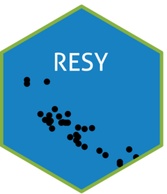

# RESY App

Classify your plots with EUNIS-ESy or your own expert system, then
explore the rules behind each assignment. RESY runs directly in your
browser through [webR](https://docs.r-wasm.org/webr/latest/). Your files
are read inside this browser tab and are not uploaded anywhere.



Starting R…

Expert system

EUNIS-ESy European habitat types (Chytrý et al. 2020), shipped with
RESY. Apennine test system A small system with five types for the
example data, shipped with RESY. Your own expert system Expert system
file, `.json` or `.txt`

Data

The files below are the example data shipped with RESY: 200 plots from
Tuscany with 3,580 species records. Choose your own files to replace
them. Files can be comma, semicolon or tab separated and of any size,
such as a full EVA export; RESY reads them in parts.

Species file: one row per species in each plot

Plot Species Cover (%)

Sites file: `PlotObservationID`, plus `Longitude` and `Latitude` (WGS84)
for EUNIS-ESy and the map, plus the header columns the expert system
reads

Use the example data again

Flag coast and dunes Coast buffer m

Classify

R sessions

plots

classified

no type's rule holds

tied at highest priority

to classify

Plots

Types

Classification

| Plot | Type | Name | Species |
|------|------|------|---------|

Download all candidates (CSV)

Why this type?

Select a plot in the table or on the map.

``` mb-0
```

runs on [webR](https://docs.r-wasm.org/webr/latest/) ·
