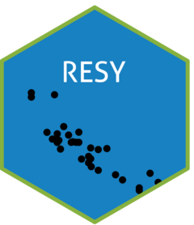

# RESY App

Classify your plots with EUNIS-ESy or your own expert system, then
explore the rules behind each assignment. RESY runs directly in your
browser through [webR](https://docs.r-wasm.org/webr/latest/). Your files
are read inside this browser tab and are not uploaded anywhere.

Starting R…

The first visit downloads R and its packages. Keep this tab open.

Retry loading

Expert system

[RESY Maker](https://florian-jansen.github.io/resy/articles/maker.md)

EUNIS-ESy European habitat types (Chytrý et al. 2020), shipped with
RESY. Apennine example system A small system with five types for the
example data, shipped with RESY. Your own expert system Expert system
file, `.json` or `.txt`

[Open this system in the RESY
Maker](https://florian-jansen.github.io/resy/articles/maker.md) to
change it or to build your own from it.

Your plot data

Choose species and sites files with matching plot IDs. Use comma,
semicolon or tab separated files. Large species files must have their
rows grouped by plot.

Species template

Sites template

Try the example data

Choose both files to begin, or try the example data.

Species file: one row per species in each plot

Plot Choose a file first Species Choose a file first Cover (%) Choose a
file first

Sites file: `PlotObservationID`, plus `Longitude` and `Latitude` (WGS84)
for EUNIS-ESy and the map, plus the header columns the expert system
reads

Flag coast and dunes Coast buffer m

Classify

R sessions at most, one per processor core

**0**plots processed

**0**classified

**0**unclassified

**0**tied types

**0 s**elapsed

Plots

Download map (SVG)

Types

Show all types

Classification

| Plot | Type | Name | Species |
|------|------|------|---------|

Download classification (CSV)

Why this type?

Select a plot in the table or on the map.

runs on [webR](https://docs.r-wasm.org/webr/latest/) ·
