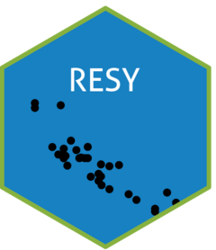

# RESY Maker

Build your own expert system: give each vegetation type a rule made of
conditions on groups of species, and fill the groups as you need them.
While you build, RESY classifies a set of test plots with your system
and shows how many plots each condition, each rule and each type
catches. Export the finished system to classify with it in the [RESY
App](https://florian-jansen.github.io/resy/articles/app.md) or with
[`resy_classify()`](https://florian-jansen.github.io/resy/reference/resy_classify.md).
Everything runs in this browser tab through
[webR](https://docs.r-wasm.org/webr/latest/); your files are not
uploaded anywhere.



Starting R…

Undo

Redo

Open…

Save

Clear…

Export…

Upload your plots

Open another system

An empty system You add the types, their groups and the species. The
Apennine example A small system with four species groups and five types
that fits the example plots. EUNIS-ESy European habitat types (Chytrý et
al. 2020), to adapt to your region or data. An expert system file
`.json` or `.txt`, to continue or change it.

Open

Clear everything?

Clear everything

Save a copy first

Cancel

Your plots

Species file: one row per species in each plot

Plot Species Cover (%)

Sites file: the plot column, plus every column a rule should read
(altitude, country, …)

Test on these files

Use the example plots again

Check

Export

Description

Download `.json`

Download `.txt`

Classify your data with it in the RESY App

The `.json` file is the format RESY reads directly. The `.txt` file has
the layout of the EUNIS-ESy releases; RESY reads it back after writing
it and compares it with the `.json` file. A system that starts from a
shipped one needs its own name once you change it. In R:

``` mb-0
```

This is the Apennine example: a few vegetation types, each with a rule
that is tested on the example plots. Change a rule and watch the plot
counts, or start your own system under **Open…**. ✕

Types

New type

&nbsp;

Test on a region

Test on all plots

Groups

Species

Plots

New group

The species of your system, each under one name. Other names for the
same species (with author, synonyms, subspecies you want to merge) are
listed under it, and RESY reads them all as that species. A species
added to a group or named in a rule is added here. Any other species
name of your data is not used in the classification.

Add names…

Add to the list

Put them back

| Plot | Type | Rules that hold |
|------|------|-----------------|

✕

runs on [webR](https://docs.r-wasm.org/webr/latest/) · your work is kept
in this browser as a draft; **Save** downloads it as a file
