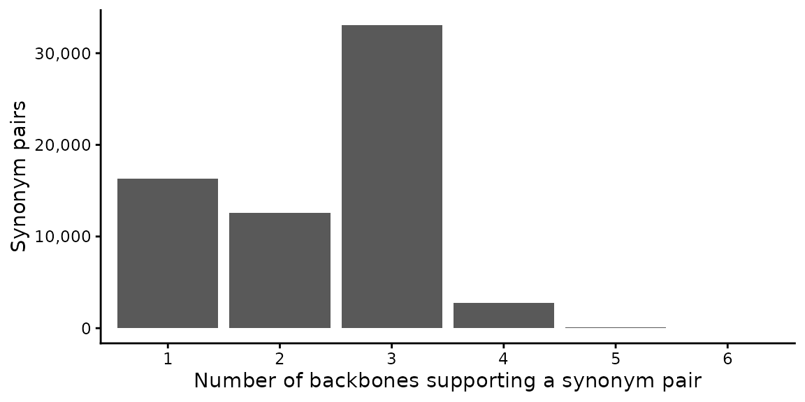

# Match species names

This vignette shows how to match species names before classifying
vegetation plots with
[`resy_classify()`](https://florian-jansen.github.io/resy/reference/resy_classify.md).
Each expert system uses a particular set of species names, and the names
in your plot data need to match.

The EUNIS expert system (Chytrý et al.
[2020](https://doi.org/10.1111/avsc.12519)), for example, uses the same
species names as the European Vegetation Archive, so data from there can
be used directly. Data following other taxonomic sources, such as GBIF,
World Flora Online, POWO or a national checklist, may use synonyms,
different author citations or spelling variants. RESY matches these
names in a separate step so you can review the matches before
classification.

1.  **Resolve** the species names with
    [`resy_resolve_taxa()`](https://florian-jansen.github.io/resy/reference/resy_resolve_taxa.md).
2.  **Inspect** the matches with
    [`summary()`](https://rdrr.io/r/base/summary.html).
3.  **Classify** the resolved data with
    [`resy_classify()`](https://florian-jansen.github.io/resy/reference/resy_classify.md).

## Example

The following R packages are required to run the example of this
vignette:

``` r

library(RESY)
library(ggplot2)
library(readr)
```

### The shipped synonym table

RESY ships a synonym table built for the EUNIS expert system: it maps
alternate species names to the names that EUNIS uses. It pools the
synonyms of six taxonomic backbones, the reference lists of accepted
names and their synonyms that taxonomic databases publish (Euro+Med,
WFO, GBIF, Catalogue of Life, ITIS, NCBI), so a name coming from any of
them can resolve without you having to say which backbone it came from.
With another expert system, the table resolves only names that point to
a species name the two systems share; for the other names, use your own
synonym table (see [Bring your own
crosswalk](#bring-your-own-crosswalk)).

The table was built on 2026-10-28 against the EUNIS expert system
2025-10-03, from the backbone releases below.
`data-raw/build_synonyms.R` in the source repository rebuilds it with
taxify 0.7.0 (Colling
[2026](https://doi.org/10.32614/CRAN.package.taxify)).

| Backbone | Release | Upstream data |
|:---------|--------:|:--------------|
| euromed  | 2026.08 | 2026-07-11    |
| wfo      | 2026.06 | 2026-06-21    |
| gbif     | 2023.08 | 2023-08-28    |
| col      | 2026.09 | 2026-09-11    |
| itis     | 2026.09 | 2026-08-27    |
| ncbi     | 2026.09 | 2026-09       |

The synonyms are binomials (genus and species epithet). Infraspecific
names, hybrid formulas, and bare genera are not in the table, so a name
of that kind is not resolved through it.

``` r

syn <- resy_read_synonyms()
nrow(syn)
#> [1] 64808
head(syn)
#>                    synonym          esy_canonical       source accepted_in
#> 1       Abelmoschus bammia Abelmoschus esculentus col;gbif;wfo        <NA>
#> 2  Abelmoschus longifolius Abelmoschus esculentus col;gbif;wfo        <NA>
#> 3      Abelmoschus praecox Abelmoschus esculentus col;gbif;wfo        <NA>
#> 4 Abelmoschus tuberculatus Abelmoschus esculentus col;gbif;wfo        <NA>
#> 5          Hibiscus bammia Abelmoschus esculentus col;gbif;wfo        <NA>
#> 6      Hibiscus ficifolius Abelmoschus esculentus col;gbif;wfo        <NA>
```

Each row is one alternate spelling (`synonym`), the EUNIS name it
resolves to (`esy_canonical`), and the backbone(s) that support the
pairing (`source`). The column `accepted_in` names the backbones that
list the synonym as an accepted name under the same author as the
synonym rows supporting the pair. A backbone appears in both `source`
and `accepted_in` when it holds an accepted row and a synonym row for
the name. The column is empty for 89% of the pairs.

``` r

head(syn[!is.na(syn$accepted_in), ], 4)
#>                 synonym     esy_canonical       source accepted_in
#> 32       Abies hudsonia    Abies balsamea      col;wfo         wfo
#> 40     Abies panachaica Abies cephalonica col;gbif;wfo        gbif
#> 41 Abies peloponnesiaca Abies cephalonica col;gbif;wfo        gbif
#> 45    Picea cephalonica Abies cephalonica col;gbif;wfo         wfo
```

A pair is listed under every backbone that supports it, so the counts
per backbone add up to more than the number of rows.

``` r

per_backbone <- table(unlist(strsplit(syn$source, ";", fixed = TRUE)))
support <- data.frame(
  backbone = names(per_backbone),
  pairs    = as.integer(per_backbone),
  share    = round(100 * as.integer(per_backbone) / nrow(syn), 1)
)
support <- support[order(-support$pairs), ]

knitr::kable(
  support,
  row.names   = FALSE,
  col.names   = c("Backbone", "Synonym pairs", "% of table"),
  format.args = list(big.mark = ",")
)
```

| Backbone | Synonym pairs | % of table |
|:---------|--------------:|-----------:|
| gbif     |        53,530 |       82.6 |
| wfo      |        46,970 |       72.5 |
| col      |        46,180 |       71.3 |
| itis     |         4,050 |        6.2 |
| ncbi     |           864 |        1.3 |
| euromed  |           588 |        0.9 |

Most pairs are supported by more than one backbone:

``` r

per_pair <- table(lengths(strsplit(syn$source, ";", fixed = TRUE)))
support_n <- data.frame(
  n_backbones = names(per_pair),
  pairs       = as.integer(per_pair)
)

ggplot(support_n, aes(x = n_backbones, y = pairs)) +
  geom_col() +
  scale_y_continuous(labels = function(x) format(x, big.mark = ",")) +
  labs(x = "Number of backbones supporting a pair", y = "Synonym pairs") +
  theme_classic()
```



### Resolve names

[`resy_resolve_taxa()`](https://florian-jansen.github.io/resy/reference/resy_resolve_taxa.md)
maps a column of names to the species names of an expert system, called
the canonical names. By default, these are the EUNIS names and the
shipped synonym table; `canonical` and `synonyms` set others (see [Bring
your own crosswalk](#bring-your-own-crosswalk)). A name that is already
a canonical name resolves to itself (`"exact"`); otherwise it is looked
up in the synonym table (`"synonym"`). A name that matches neither is
matched again with its author citation removed by
[`resy_clean_names()`](https://florian-jansen.github.io/resy/reference/resy_clean_names.md)
(`"cleaned_exact"`, `"cleaned_synonym"`); the name in your data is left
as it is. A name that still matches nothing stays `NA` and is flagged
`"unresolved"`. Nothing is ever replaced with a best guess.

``` r

plots <- data.frame(
  TaxonName = c(
    "Hibiscus praecox",        # a synonym in the shipped table
    "Abelmoschus longifolius",  # another synonym
    "Fagus sylvatica",          # already a canonical name
    "Anemone nemorosa L.",      # canonical name with an author citation
    "Not a real species 123"    # resolves to nothing
  ),
  stringsAsFactors = FALSE
)

resolved <- resy_resolve_taxa(plots, species_col = "TaxonName")
resolved
#> <resy_taxa> 5 name(s) from column `TaxonName` resolved against 20158 reference names
#>   TaxonName         name as submitted
#>   canonical         resolved canonical name; NA when unresolved
#>   taxon_confidence  exact, synonym, cleaned_exact, cleaned_synonym or unresolved
#>   matched           TRUE if the name resolved
#> 4 matched (80.0%), 1 unmatched; summary() lists them
#> 
#>                 TaxonName              canonical taxon_confidence matched
#> 1        Hibiscus praecox Abelmoschus esculentus          synonym    TRUE
#> 2 Abelmoschus longifolius Abelmoschus esculentus          synonym    TRUE
#> 3         Fagus sylvatica        Fagus sylvatica            exact    TRUE
#> 4     Anemone nemorosa L.       Anemone nemorosa    cleaned_exact    TRUE
#> 5  Not a real species 123                   <NA>       unresolved   FALSE
```

The result is a `resy_taxa` table, the same kind
[`resy_check_taxonomy()`](https://florian-jansen.github.io/resy/reference/resy_check_taxonomy.md)
returns.
[`summary()`](https://rspatial.github.io/terra/reference/summary.html)
reports how many names and records resolved, the records by match type,
and the distinct names that stayed unresolved.

``` r

summary(resolved)
#> 5 names checked: 4 matched (80.0%), 1 not matched (20.0%).
#> 
#> Records by match type:
#>   cleaned_exact  1  (20.0%)
#>   exact          1  (20.0%)
#>   synonym        2  (40.0%)
#>   unresolved     1  (20.0%)
#> 
#> Not matched:
#>   species (1): Not a real species 123
```

Unresolved names can be fixed by correcting a spelling, adding a row to
your own crosswalk, or leaving them out.

### Bring your own crosswalk

[`resy_resolve_taxa()`](https://florian-jansen.github.io/resy/reference/resy_resolve_taxa.md)
also accepts your own crosswalk, with three columns: `synonym`,
`esy_canonical`, and `source`. It can come from a national checklist, a
Turboveg species list, or a name-matching package such as
[taxify](https://github.com/gcol33/taxify) or
[taxize](https://CRAN.R-project.org/package=taxize) (Chamberlain & Szocs
[2013](https://f1000research.com/articles/2-191/v2)). A small example
ships with the package.

``` r

cw_path <- system.file("extdata", "example_crosswalk.csv", package = "RESY")
crosswalk <- resy_read_synonyms(cw_path)
crosswalk
#>               synonym    esy_canonical               source
#> 1     Fagus silvatica  Fagus sylvatica orthographic variant
#> 2    Pinus silvestris Pinus sylvestris orthographic variant
#> 3     Abies pectinata       Abies alba    taxonomic synonym
#> 4   Nardus stricta L.   Nardus stricta      author citation
#> 5 Anemone nemorosa L. Anemone nemorosa      author citation
```

Pass it to `synonyms=`, and give the target names to `canonical=` so
resolution uses your table alone:

``` r

my_plots <- data.frame(
  TaxonName = c("Fagus silvatica", "Abies pectinata", "Quercus robur"),
  stringsAsFactors = FALSE
)

resy_resolve_taxa(
  my_plots,
  species_col = "TaxonName",
  synonyms    = crosswalk,
  canonical   = unique(crosswalk$esy_canonical)
)
#> <resy_taxa> 3 name(s) from column `TaxonName` resolved against 5 reference names
#>   TaxonName         name as submitted
#>   canonical         resolved canonical name; NA when unresolved
#>   taxon_confidence  exact, synonym, cleaned_exact, cleaned_synonym or unresolved
#>   matched           TRUE if the name resolved
#> 2 matched (66.7%), 1 unmatched; summary() lists them
#> 
#>         TaxonName       canonical taxon_confidence matched
#> 1 Fagus silvatica Fagus sylvatica          synonym    TRUE
#> 2 Abies pectinata      Abies alba          synonym    TRUE
#> 3   Quercus robur            <NA>       unresolved   FALSE
```

If your crosswalk lives in an Excel sheet, read it yourself and pass the
data frame. RESY validates the columns and uses it directly, so it needs
no Excel package as a dependency:

``` r

crosswalk <- readxl::read_excel("my_crosswalk.xlsx")
resy_resolve_taxa(my_plots, synonyms = crosswalk,
                  canonical = unique(crosswalk$esy_canonical))
```

A synonym that maps to more than one canonical name is dropped, so an
ambiguous table cannot produce a silent substitution.

### Classify the resolved data

Once the names match the species list of the expert system, classify as
usual. Resolve them against the species list of the expert system you
classify with (here `Apennine-test`), write the resolved name back to
the name column, keeping the original where a name did not resolve, and
pass the result to
[`resy_classify()`](https://florian-jansen.github.io/resy/reference/resy_classify.md).
The species list is taken from `expert$aggs`, which holds the taxa of
the expert system: each name is a taxon the rules use, and its elements
are the names counted as that taxon.

``` r

species <- read_csv(
  system.file("extdata", "data_example_species.csv", package = "RESY"),
  show_col_types = FALSE
)
species <- head(species, 200)   # keep the example quick

obs <- data.frame(
  PlotObservationID = species$PlotObservationID,
  TaxonName         = species$scientificName,
  Cover_Perc        = species$Cover_Perc,
  stringsAsFactors  = FALSE
)
expert <- resy_load_expert(scheme = "Apennine-test")
expert_vocab <- unique(c(names(expert$aggs), unlist(expert$aggs, use.names = FALSE)))

resolved_obs <- resy_resolve_taxa(
  obs, species_col = "TaxonName", canonical = expert_vocab
)
table(resolved_obs$taxon_confidence)
#> 
#> exact 
#>   200

resolved_obs$TaxonName <- ifelse(
  is.na(resolved_obs$canonical), resolved_obs$TaxonName, resolved_obs$canonical
)
obs <- resolved_obs[c("PlotObservationID", "TaxonName", "Cover_Perc")]
header <- as.data.frame(unique(obs["PlotObservationID"]))

res <- resy_classify(obs, header, scheme = "Apennine-test")
head(res$result.classification)
#> HU32 KW76 YB18 NX70 OL48 YL40 
#>  "F"  "F"  "F"  "F"  "F"  "F"
```

For a quick pass, `resy_classify(..., resolve_taxa = TRUE)` runs the
resolution against the species list of the expert system and then
classifies in a single call, and reports what it did in
`res$taxon_resolution`. The two-step route above is recommended, since
it lets you check the unresolved names before they reach the classifier.

## References

Chamberlain S, Szocs E
([2013](https://f1000research.com/articles/2-191/v2)) taxize: taxonomic
search and retrieval in R. – *F1000Research* 2, 191.
<https://f1000research.com/articles/2-191/v2>

Chytrý M, Tichý L, Hennekens SM, Knollová I et
al. ([2020](https://doi.org/10.1111/avsc.12519)) EUNIS Habitat
Classification: expert system, characteristic species combinations and
distribution maps of European habitats. – *Applied Vegetation Science*
23, 648–675. <https://doi.org/10.1111/avsc.12519>

Colling G ([2026](https://doi.org/10.32614/CRAN.package.taxify)) taxify:
Offline Taxonomic Name Matching Against Darwin Core Backbones. – R
package version 0.7.0. <https://doi.org/10.32614/CRAN.package.taxify>
