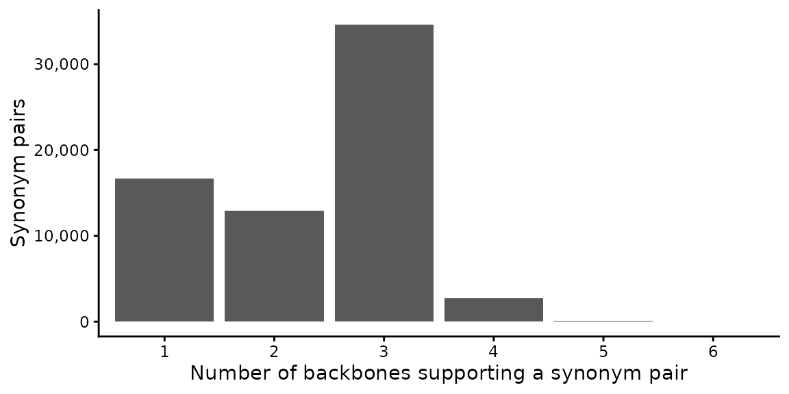

# Match species names

This vignette shows how to match species names before classifying
vegetation plots with
[`resy_classify()`](https://florian-jansen.github.io/resy/reference/resy_classify.md).
Each expert system uses a particular set of species names, and the names
in your plot data need to match.

The EUNIS expert system (Chytrý et al.
[2020](https://doi.org/10.1111/avsc.12519)), for example, uses the same
species names as the European Vegetation Archive (Chytrý et
al. [2016](https://doi.org/10.1111/avsc.12191)), so data from there can
be used directly. Data following other taxonomic sources, such as
[GBIF](https://www.gbif.org/), [World Flora
Online](https://www.worldfloraonline.org/),
[POWO](https://powo.science.kew.org/) or a national checklist, may use
synonyms, different author citations or spelling variants. RESY matches
these names in a separate step so you can review the matches before
classification.

1.  **Resolve** the species names with
    [`resy_resolve_taxa()`](https://florian-jansen.github.io/resy/reference/resy_resolve_taxa.md).
2.  **Inspect** the matches with
    [`summary()`](https://rdrr.io/r/base/summary.html).
3.  **Classify** the vegetation surveys with the resolved data with
    [`resy_classify()`](https://florian-jansen.github.io/resy/reference/resy_classify.md).

## Example

The following R packages are required to run the example of this
vignette:

``` r

library(RESY)
library(ggplot2)
library(readr)
```

### Resolve names

[`resy_resolve_taxa()`](https://florian-jansen.github.io/resy/reference/resy_resolve_taxa.md)
maps a column of names to the species names of an expert system. By
default, this is the newest release of the EUNIS expert system that
ships with RESY; the argument `expert` takes any other expert system
read with
[`resy_load_expert()`](https://florian-jansen.github.io/resy/reference/resy_load_expert.md).
The names come from the expert system itself, not from a taxonomic
database. The canonical names are the names its classifier evaluates:
the species aggregates of Section 1 of the expert system, and the
species that a species group or a rule names and that no aggregate
includes.
[`resy_canonical_species()`](https://florian-jansen.github.io/resy/reference/resy_canonical_species.md)
returns them.

Each name is looked up in up to four steps, and the first step that
finds it sets the match type:

1.  The name is a species name the expert system uses, a canonical name
    or a name it lists in an aggregate (`"exact"`).
2.  The name is in the synonym table (`"synonym"`), described in [The
    shipped synonym table](#the-shipped-synonym-table).
3.  With its author citation removed by
    [`resy_clean_names()`](https://florian-jansen.github.io/resy/reference/resy_clean_names.md),
    the name is a species name the expert system uses
    (`"cleaned_exact"`).
4.  With its author citation removed, the name is in the synonym table
    (`"cleaned_synonym"`).

The name without author citation is used only for the lookup; the name
column in your data keeps the name as submitted. A name that none of the
four steps finds stays `NA` and is flagged `"unresolved"`. Nothing is
ever replaced with a best guess.

``` r

plots <- data.frame(
  TaxonName = c(
    "Hibiscus praecox",        # a synonym in the shipped table
    "Abelmoschus longifolius",  # another synonym
    "Fagus sylvatica",          # already a canonical name
    "Anemone nemorosa L.",      # canonical name with an author citation
    "Not a real species 123"    # resolves to nothing
  ),
  stringsAsFactors = FALSE
)

resolved <- resy_resolve_taxa(plots, species_col = "TaxonName")
resolved
#> <resy_taxa> 5 name(s) from column `TaxonName` resolved against 121877 reference names
#>   TaxonName         name as submitted
#>   canonical         resolved canonical name; NA when unresolved
#>   taxon_confidence  exact, synonym, cleaned_exact, cleaned_synonym or unresolved
#>   matched           TRUE if the name resolved
#> 4 matched (80.0%), 1 unmatched; summary() lists them
#> 
#>                 TaxonName              canonical taxon_confidence matched
#> 1        Hibiscus praecox Abelmoschus esculentus          synonym    TRUE
#> 2 Abelmoschus longifolius Abelmoschus esculentus          synonym    TRUE
#> 3         Fagus sylvatica        Fagus sylvatica            exact    TRUE
#> 4     Anemone nemorosa L.       Anemone nemorosa    cleaned_exact    TRUE
#> 5  Not a real species 123                   <NA>       unresolved   FALSE
```

The result is a `resy_taxa` table, the same kind
[`resy_check_taxonomy()`](https://florian-jansen.github.io/resy/reference/resy_check_taxonomy.md)
returns.
[`summary()`](https://rspatial.github.io/terra/reference/summary.html)
reports how many names and records resolved, the records by match type,
and the distinct names that stayed unresolved.

``` r

summary(resolved)
#> 5 names checked: 4 matched (80.0%), 1 not matched (20.0%).
#> 
#> Records by match type:
#>   cleaned_exact  1  (20.0%)
#>   exact          1  (20.0%)
#>   synonym        2  (40.0%)
#>   unresolved     1  (20.0%)
#> 
#> Not matched:
#>   species (1): Not a real species 123
```

Unresolved names can be fixed by correcting a spelling, adding a row to
your own crosswalk (see [Bring your own
crosswalk](#bring-your-own-crosswalk)), or leaving them out.

### The shipped synonym table

RESY ships one set of synonyms for all expert systems and all their
releases. It pools the synonyms of six taxonomic backbones, the
reference lists of accepted names and their synonyms that taxonomic
databases publish (Euro+Med (europlusmed.org),
[WFO](https://www.worldfloraonline.org/), [GBIF](https://www.gbif.org/),
[Catalogue of Life](https://www.catalogueoflife.org/),
[ITIS](https://www.itis.gov/),
[NCBI](https://www.ncbi.nlm.nih.gov/datasets/taxonomy/)), so a name
coming from any of them can resolve without you having to say which
backbone it came from. These 194,420 synonym pairs point to Euro+Med
names and to the canonical names of the expert systems that ship with
RESY.

When synonyms are needed, RESY turns this set into a synonym table for
the expert system in use, so each release of an expert system gets a
table that fits its own species names:

- A synonym pair is kept when the name it points to is a canonical name
  of the expert system.
- A synonym that points to two names the expert system evaluates
  differently is resolved by Euro+Med, the taxonomy that the EUNIS
  expert system follows. When Euro+Med gives a single answer it is kept;
  otherwise the synonym stays unresolved.
- A name the expert system already uses is never remapped.
- A synonym that Euro+Med accepts as a species of its own is kept only
  when Euro+Med treats it as the same taxon as the name it points to,
  such as a spelling variant.

With an expert system whose species names follow another taxonomy, the
table resolves only names that point to a name the expert system uses;
for the other names, use your own synonym table (see [Bring your own
crosswalk](#bring-your-own-crosswalk)).

The synonym pairs were collected on 2026-11-23 from the backbone
releases below. `data-raw/build_synonyms.R` in the source repository
collects them again with taxify 0.7.1 (Colling
[2026](https://doi.org/10.32614/CRAN.package.taxify)).

| Backbone | Upstream data |
|:---------|:--------------|
| euromed  | 2026-07-11    |
| wfo      | 2026-06-21    |
| gbif     | 2023-08-28    |
| col      | 2026-09-11    |
| itis     | 2026-08-27    |
| ncbi     | 2026-09       |

The synonyms are binomials (genus and species epithet). Infraspecific
names, hybrid formulas, and bare genera are not in the table, so a name
of that kind is not resolved through it.

[`resy_read_synonyms()`](https://florian-jansen.github.io/resy/reference/resy_read_synonyms.md)
without arguments returns the synonym table of the newest EUNIS release;
its argument `expert` takes any other expert system:

``` r

syn <- resy_read_synonyms()
nrow(syn)
#> [1] 67018
head(syn)
#>                    synonym          esy_canonical       source accepted_in
#> 1       Abelmoschus bammia Abelmoschus esculentus col;gbif;wfo        <NA>
#> 2  Abelmoschus longifolius Abelmoschus esculentus col;gbif;wfo        <NA>
#> 3      Abelmoschus praecox Abelmoschus esculentus col;gbif;wfo        <NA>
#> 4 Abelmoschus tuberculatus Abelmoschus esculentus col;gbif;wfo        <NA>
#> 5          Hibiscus bammia Abelmoschus esculentus col;gbif;wfo        <NA>
#> 6      Hibiscus ficifolius Abelmoschus esculentus col;gbif;wfo        <NA>
```

Each row of the table is a synonym pair: an alternate spelling
(`synonym`) and the EUNIS name it resolves to (`esy_canonical`), with
the backbone(s) that list the synonym under that name (`source`). The
column `accepted_in` names the backbones that list the same synonym as
an accepted name of its own, by the same author as in the backbones of
`source` (an accepted name by another author is a different taxon with
the same name and is not counted). A backbone appears in both `source`
and `accepted_in` when it holds an accepted row and a synonym row for
the name.

The column is empty for 89% of the synonym pairs: no backbone accepts
these synonyms as species of their own, so every backbone that lists the
name agrees that it is a synonym. A filled `accepted_in` marks a name
that one backbone treats as a synonym and another as a separate species:

``` r

head(syn[!is.na(syn$accepted_in), ], 4)
#>                 synonym     esy_canonical       source accepted_in
#> 31       Abies hudsonia    Abies balsamea      col;wfo         wfo
#> 39     Abies panachaica Abies cephalonica col;gbif;wfo        gbif
#> 40 Abies peloponnesiaca Abies cephalonica col;gbif;wfo        gbif
#> 44    Picea cephalonica Abies cephalonica col;gbif;wfo         wfo
```

A synonym pair with several backbones in `source` is counted once for
each of them, so the counts per backbone add up to more than the number
of rows.

``` r

per_backbone <- table(unlist(strsplit(syn$source, ";", fixed = TRUE)))
support <- data.frame(
  backbone = names(per_backbone),
  pairs    = as.integer(per_backbone),
  share    = round(100 * as.integer(per_backbone) / nrow(syn), 1)
)
support <- support[order(-support$pairs), ]

knitr::kable(
  support,
  row.names   = FALSE,
  col.names   = c("Backbone", "Synonym pairs", "% of table"),
  format.args = list(big.mark = ",")
)
```

| Backbone | Synonym pairs | % of table |
|:---------|--------------:|-----------:|
| gbif     |        55,750 |       83.2 |
| wfo      |        48,459 |       72.3 |
| col      |        48,027 |       71.7 |
| itis     |         4,125 |        6.2 |
| ncbi     |           949 |        1.4 |
| euromed  |           392 |        0.6 |

The backbones also differ in size: in the releases above, the GBIF
backbone holds 3,034,449 synonym rows and the Euro+Med backbone 85,335.
Euro+Med synonyms are also often names that the EUNIS expert system
lists in its own species aggregates; the classifier already counts
those, so the table leaves them out.

Most synonym pairs are supported by more than one backbone:

``` r

per_pair <- table(lengths(strsplit(syn$source, ";", fixed = TRUE)))
support_n <- data.frame(
  n_backbones = names(per_pair),
  pairs       = as.integer(per_pair)
)

ggplot(support_n, aes(x = n_backbones, y = pairs)) +
  geom_col() +
  scale_y_continuous(labels = function(x) format(x, big.mark = ",")) +
  labs(x = "Number of backbones supporting a synonym pair", y = "Synonym pairs") +
  theme_classic()
```



### Bring your own crosswalk

A crosswalk is a table that maps each name of one name list to the
matching name in another, here from the names in your data to the
canonical names of the expert system. The synonym table of RESY is one;
[`resy_resolve_taxa()`](https://florian-jansen.github.io/resy/reference/resy_resolve_taxa.md)
also accepts your own, with three columns: `synonym`, `esy_canonical`,
and `source`. It can come from a national checklist, a Turboveg species
list, or a name-matching package such as
[taxify](https://github.com/gcol33/taxify) or
[taxize](https://doi.org/10.32614/CRAN.package.taxize) (Chamberlain &
Szocs [2013](https://f1000research.com/articles/2-191/v2)). A small
example ships with the package.

``` r

cw_path <- system.file("extdata", "example_crosswalk.csv", package = "RESY")
crosswalk <- resy_read_synonyms(cw_path)
crosswalk
#>               synonym    esy_canonical               source
#> 1     Fagus silvatica  Fagus sylvatica orthographic variant
#> 2    Pinus silvestris Pinus sylvestris orthographic variant
#> 3     Abies pectinata       Abies alba    taxonomic synonym
#> 4   Nardus stricta L.   Nardus stricta      author citation
#> 5 Anemone nemorosa L. Anemone nemorosa      author citation
```

Pass it to `synonyms=`, and give the target names to `canonical=` so
resolution uses your table alone:

``` r

my_plots <- data.frame(
  TaxonName = c("Fagus silvatica", "Abies pectinata", "Quercus robur"),
  stringsAsFactors = FALSE
)

resy_resolve_taxa(
  my_plots,
  species_col = "TaxonName",
  synonyms    = crosswalk,
  canonical   = unique(crosswalk$esy_canonical)
)
#> <resy_taxa> 3 name(s) from column `TaxonName` resolved against 5 reference names
#>   TaxonName         name as submitted
#>   canonical         resolved canonical name; NA when unresolved
#>   taxon_confidence  exact, synonym, cleaned_exact, cleaned_synonym or unresolved
#>   matched           TRUE if the name resolved
#> 2 matched (66.7%), 1 unmatched; summary() lists them
#> 
#>         TaxonName       canonical taxon_confidence matched
#> 1 Fagus silvatica Fagus sylvatica          synonym    TRUE
#> 2 Abies pectinata      Abies alba          synonym    TRUE
#> 3   Quercus robur            <NA>       unresolved   FALSE
```

If your crosswalk lives in an Excel sheet, read it yourself and pass the
data frame. RESY validates the columns and uses it directly, so it needs
no Excel package as a dependency:

``` r

crosswalk <- readxl::read_excel("my_crosswalk.xlsx")
resy_resolve_taxa(my_plots, synonyms = crosswalk,
                  canonical = unique(crosswalk$esy_canonical))
```

A synonym that maps to more than one canonical name is dropped, so an
ambiguous table cannot produce a silent substitution.

### Classify the resolved data

Once the names match the species list of the expert system, classify as
in [Get
started](https://florian-jansen.github.io/resy/articles/RESY.md).
Resolve them against the species list of the expert system you classify
with (here `Apennine-test`), write the resolved name back to the name
column, keeping the original where a name did not resolve, and pass the
result to
[`resy_classify()`](https://florian-jansen.github.io/resy/reference/resy_classify.md).
The species list is taken from `expert$aggs`, which holds the taxa of
the expert system: each name is a taxon the rules use, and its elements
are the names counted as that taxon.

``` r

species <- read_csv(
  system.file("extdata", "data_example_species.csv", package = "RESY"),
  show_col_types = FALSE
)
species <- head(species, 200)   # keep the example quick

obs <- data.frame(
  PlotObservationID = species$PlotObservationID,
  TaxonName         = species$scientificName,
  Cover_Perc        = species$Cover_Perc,
  stringsAsFactors  = FALSE
)
expert <- resy_load_expert(scheme = "Apennine-test")
expert_vocab <- unique(c(names(expert$aggs), unlist(expert$aggs, use.names = FALSE)))

resolved_obs <- resy_resolve_taxa(
  obs, species_col = "TaxonName", canonical = expert_vocab
)
table(resolved_obs$taxon_confidence)
#> 
#> exact 
#>   200

resolved_obs$TaxonName <- ifelse(
  is.na(resolved_obs$canonical), resolved_obs$TaxonName, resolved_obs$canonical
)
obs <- resolved_obs[c("PlotObservationID", "TaxonName", "Cover_Perc")]
header <- as.data.frame(unique(obs["PlotObservationID"]))

res <- resy_classify(obs, header, scheme = "Apennine-test")
head(res$result.classification)
#> HU32 KW76 YB18 NX70 OL48 YL40 
#>  "F"  "F"  "F"  "F"  "F"  "F"
```

For a quick pass, `resy_classify(..., resolve_taxa = TRUE)` runs the
resolution against the species list of the expert system and then
classifies in a single call, and reports what it did in
`res$taxon_resolution`. The two-step route above is recommended, since
it lets you check the unresolved names before they reach the classifier.

## References

Chamberlain S, Szocs E
([2013](https://f1000research.com/articles/2-191/v2)) taxize: taxonomic
search and retrieval in R. – *F1000Research* 2, 191.
<https://f1000research.com/articles/2-191/v2>

Chytrý M, Tichý L, Hennekens SM, Knollová I et
al. ([2020](https://doi.org/10.1111/avsc.12519)) EUNIS Habitat
Classification: expert system, characteristic species combinations and
distribution maps of European habitats. – *Applied Vegetation Science*
23, 648–675. <https://doi.org/10.1111/avsc.12519>

Colling G ([2026](https://doi.org/10.32614/CRAN.package.taxify)) taxify:
Offline Taxonomic Name Matching Against Darwin Core Backbones. – R
package version 0.7.1. <https://doi.org/10.32614/CRAN.package.taxify>
